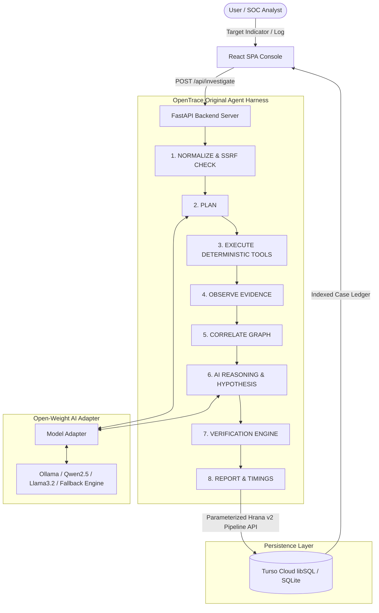

# OpenTrace AI — Open-Source AI Cyber Investigation Agent

> **Evidence-Grounded Cybersecurity Investigation Agent Powered by Open-Weight AI & Turso Cloud**

[](LICENSE)
[](backend/main.py)
[](https://turso.tech)
[](skills/cyber-investigator/SKILL.md)
[](.github/workflows/security.yml)

OpenTrace AI is a cybersecurity investigation agent designed for Security Operations Centers (SOC), incident responders, and digital forensics analysts. It combines open-weight language models (Qwen, Llama, Mistral) with deterministic security tools, adjacency graph correlation, and persistent database storage.

---

## Central Principle

> **"AI Proposes. Evidence Verifies."**

Traditional security AI tools often present LLM-generated summaries as factual intelligence. OpenTrace AI strictly separates **Observed Facts**, **Correlated Relationships**, and **AI Hypotheses**. An AI-generated hypothesis is never accepted as fact without empirical tool evidence.

### Verification States

- **`OBSERVED`**: Direct fact obtained from a deterministic analysis tool (e.g. DNS resolution, PTR lookup, hash signature match).
- **`CORRELATED`**: Multi-entity relationship derived from two or more observed indicators (e.g. domain resolving to an observed IP address).
- **`HYPOTHESIS`**: AI-generated interpretation or campaign theory proposed by the language model.
- **`VERIFIED`**: An AI hypothesis or finding supported by $\ge 2$ independent tool observations or a known threat signature.
- **`UNVERIFIED`**: An AI hypothesis for which sufficient supporting empirical evidence is absent.

---

## 🏗️ System Architecture



---

## 🔄 8-Stage Agent Harness Lifecycle

OpenTrace AI uses an original lightweight agent harness lifecycle:

1. **INPUT**: Receive raw indicator (IPv4, IPv6, Domain, URL, Hash, Email, Wallet, or multiline Log text up to 10KB).
2. **NORMALIZE**: Strip control characters, sanitize whitespace, classify indicator type using regex validators.
3. **PLAN**: Generate an investigation plan mapping indicator type to required deterministic security tools.
4. **EXECUTE**: Run deterministic tools (DNS lookup, WHOIS/IP classification, Hash signature check, Shannon entropy analysis, Crypto wallet format check, Log parser).
5. **OBSERVE**: Record immutable tool observations into the evidence ledger with timestamps and provenance.
6. **CORRELATE**: Construct an adjacency relationship graph mapping connections between entities (e.g. `domain:example.com` $\rightarrow$ `RESOLVES_TO` $\rightarrow$ `ip:1.1.1.1`).
7. **VERIFY**: Evaluate AI hypotheses against observed evidence. Classify findings into strict verification states (`OBSERVED`, `CORRELATED`, `HYPOTHESIS`, `VERIFIED`, `UNVERIFIED`).
8. **REPORT**: Format structured findings, evidence ledger, relationship graph, and performance timing metrics.

---

## 🛡️ OWASP Top 10:2025 Assessment & Status Table

OpenTrace AI is reviewed against relevant categories of the **OWASP Top 10:2025** security framework:

| OWASP Category | Applied Controls & Implementation | Status |
|---|---|---|
| **A01:2025 — Broken Access Control** | SSRF input validation blocking loopbacks (`127.0.0.1`, `::1`), private subnets (`10.0.0.0/8`, `172.16.0.0/12`, `192.168.0.0/16`), cloud metadata (`169.254.169.254`), IPv4-mapped IPv6 subnets, and URL credentials. Sanitize case IDs. | **Implemented** |
| **A02:2025 — Security Misconfiguration** | Secrets isolated to `.env` (ignored in `.gitignore`); safe template provided in `.env.example`. Stack trace suppression in production error handlers. | **Implemented** |
| **A03:2025 — Software Supply Chain Failures** | Minimal dependency set (`fastapi`, `uvicorn`, `requests`, `httpx`, `pydantic`). Automated GitHub Actions workflow (`.github/workflows/security.yml`) configured for `pip-audit` scanning. | **Partial** *(Scanning configured; lockfiles deployment-dependent)* |
| **A04:2025 — Cryptographic Failures** | HTTPS is required for Turso HTTP API communication (`https://...turso.io/v2/pipeline`). Auth token isolated server-side. | **Implemented** |
| **A05:2025 — Injection** | Parameterized query bindings (`?`) across SQLite and Turso Hrana JSON payloads. Zero dynamic code calls (`eval`, `exec`, `os.system`). Max input length 10KB. | **Implemented** |
| **A06:2025 — Insecure Design** | Verification Engine ("AI Proposes. Evidence Verifies.") enforcing `UNVERIFIED` state for unsupported AI claims. Evidence isolated in passive `<untrusted_evidence_data>` tags. | **Implemented** |
| **A07:2025 — Authentication Failures** | OpenTrace AI currently targets a local/single-user deployment and does not implement multi-user authentication or authorization. | **Not Implemented** *(Deployment Scope)* |
| **A08:2025 — Software & Data Integrity** | Evidence stored with source tool provenance and verification state flags. AI hypotheses cannot mutate raw observation feeds. | **Implemented** |
| **A09:2025 — Security Logging & Alerting Failures** | Security-event logging is implemented (recording case IDs, indicators, latencies, SSRF blocks); external real-time alerting is deployment-dependent. | **Partial** *(Logging implemented; Alerting deployment-dependent)* |
| **A10:2025 — Mishandling of Exceptional Conditions** | Resilient fallback reasoning engine for offline LLM endpoints (`OpenWeightModelAdapter`). Controlled error handling for network/database timeouts. | **Implemented** |

---

## 📊 Algorithmic Complexity

| Operation | Time Complexity | Space Complexity | Description |
|---|---|---|---|
| **Input Normalization** | $O(n)$ | $O(n)$ | Strips control characters & runs regex pattern matching where $n$ is raw input string length ($n \le 10{,}000$). |
| **SSRF Safety Check** | $O(1) + O(\text{DNS})$ | $O(1)$ | URL scheme & subnet parsing $O(1)$ plus network hostname resolution $O(\text{DNS})$. |
| **Tool Execution** | Concurrent: $O(\max(T_1, \dots, T_k))$<br>Sequential: $O(\sum_{i=1}^k T_i)$ | $O(k + S_{\text{evidence}})$ | Runs $k$ deterministic tools ($k \le 4$) in memory. |
| **Adjacency Graph Correlation** | $O(N + E)$ | $O(N + E)$ | Constructs adjacency list for $N$ entity nodes and $E$ relationship edges. |
| **Evidence Verification** | $O(F \times O)$ | $O(F)$ | Matches $F$ findings against $O$ evidence observations. |
| **Database Lookup** | $O(\log N)$ | $O(1)$ | B-tree index lookup (`idx_cases_indicator`, `idx_findings_case`) for database table with $N$ rows. |

---

## ⚡ Measured Runtime Benchmarks

Measured using the empirical test suite (`backend/test_suite.py`) across 3 iterations:

| Target Indicator Type | Local CPU Processing Latency (Mean) | Total Pipeline Latency (Incl. Model Endpoint Wait) |
|---|---|---|
| **IPv4 Address (`1.1.1.1`)** | $3.54\text{ ms}$ *(Local CPU)* | $8{,}156.70\text{ ms}$ *(Model timeout fallback)* |
| **Domain (`example.com`)** | $1.06\text{ ms}$ *(Local CPU)* | $8{,}138.68\text{ ms}$ *(Model timeout fallback)* |
| **WannaCry Hash** | $0.06\text{ ms}$ *(Local CPU)* | $8{,}113.75\text{ ms}$ *(Model timeout fallback)* |
| **Ethereum Wallet** | $0.06\text{ ms}$ *(Local CPU)* | $8{,}054.61\text{ ms}$ *(Model timeout fallback)* |
| **Suspicious Log Event** | $0.26\text{ ms}$ *(Local CPU)* | $8{,}147.81\text{ ms}$ *(Model timeout fallback)* |

*Note: Local CPU deterministic processing latency excludes external network calls and model API timeouts.*

---

## 🗄️ Database Architecture & Turso Hrana v2

OpenTrace AI uses a `DatabaseClient` supporting Turso libSQL Cloud via Hrana v2 HTTP pipeline protocol (`/v2/pipeline`), with automatic fallback to local SQLite (`opentrace.db`):

- **`cases`**: `(id PK, indicator, indicator_type, threat_level, status, created_at, duration_ms)`
- **`indicators`**: `(id PK, case_id, value, type, reputation, created_at)`
- **`evidence`**: `(id PK, case_id, source, evidence_type, content, created_at)`
- **`relationships`**: `(id PK, case_id, source_indicator, target_indicator, relation_type)`
- **`findings`**: `(id PK, case_id, title, hypothesis, verification_status, evidence_sources, confidence, created_at)`

### Database Performance Indexes
- `idx_cases_indicator` ON `cases(indicator)`
- `idx_cases_created` ON `cases(created_at)`
- `idx_indicators_case` ON `indicators(case_id)`
- `idx_evidence_case` ON `evidence(case_id)`
- `idx_relationships_case` ON `relationships(case_id)`
- `idx_findings_case` ON `findings(case_id)`

---

## 📦 Agent Skill Specification

OpenTrace AI includes an Agent Skill specification compliant with the Agent Skill Open Standard located at:

```text
skills/cyber-investigator/SKILL.md
```

```yaml
---
name: cyber-investigator
description: Investigate cybersecurity indicators using evidence collection, correlation, AI-assisted hypothesis generation, and evidence verification.
license: Apache-2.0
version: 1.0.0
---
```

---

## 🚀 Quickstart & Setup Guide

### 1. Clone Repository & Install Dependencies
```bash
git clone https://github.com/RAMINENI-TEJA-24MEI10040/OS-AI-.git
cd OS-AI-

# Install Python requirements
pip install -r backend/requirements.txt
```

### 2. Configure Environment Variables
Copy `.env.example` to `.env`:
```bash
cp .env.example .env
```
Fill in your Turso database credentials:
```env
TURSO_DATABASE_URL=libsql://your-database.turso.io
TURSO_AUTH_TOKEN=your_secret_turso_token
MODEL_ENDPOINT=http://localhost:11434/api/generate
```

### 3. Run Benchmark & Security Tests
```bash
python backend/test_suite.py
```

### 4. Launch OpenTrace AI Server
```bash
python backend/main.py
```
Open your browser to: **`http://localhost:8000`**

---

## 📁 Repository Structure

```text
OS-AI-/
│
├── .github/
│   └── workflows/
│       └── security.yml  # GitHub Actions Audit & Test Workflow
│
├── frontend/
│   ├── index.html        # Single Page Application HTML Entrypoint
│   ├── app.jsx           # React SOC Console & Investigation Workstation
│   └── style.css         # High-contrast Cybersecurity Theme & Typography
│
├── backend/
│   ├── main.py           # FastAPI Server & Turso/SQLite Database Engine
│   ├── agent.py          # OpenTrace Agent Harness, Verification & Tools
│   ├── test_suite.py     # SSRF Security & Performance Benchmark Suite
│   └── requirements.txt  # Minimal Backend Dependencies
│
├── skills/
│   └── cyber-investigator/
│       └── SKILL.md      # Agent Skill Open Standard Specification
│
├── .env.example          # Safe Environment Template
├── .gitignore            # Secret & Artifact Exclusion
├── LICENSE               # Apache-2.0 Open Source License
└── README.md             # Technical Documentation & Security Assessment
```

---

## 📜 License

Licensed under the [Apache License 2.0](LICENSE).